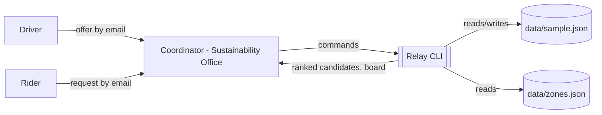
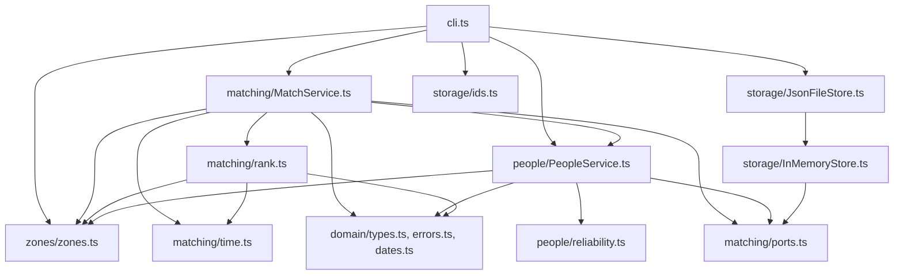

# Relay: architecture notes

Handover notes from the previous developer. Everything a new contributor needs to
orient themselves is here; the code is the source of truth where the two disagree.

## Context

Relay is a one-day carpool matcher for commuting students at (fictional) Mount Hood
Community College. The Sustainability Office runs it from a laptop: a coordinator types
in the offers and requests students send by email or form, runs `propose` for each
request, and relays the result back. Students never touch the tool directly.

In scope: offers and requests for a single date, zone-and-time matching with a ranked
list of candidates, a seat count per offer, a simple reliability score, and a daily
board. Out of scope, deliberately: recurring offers, a web interface, notifications,
payments, maps or distances, and concurrent users. One JSON file is the database.

## Components

- `domain/` has the entity types (readonly plain objects), `DomainError` with its
  `code`, and the ISO-date helpers. No logic beyond validation.
- `matching/ports.ts` is the set of interfaces everything is injected through:
  `RelayStore` (four `Collection`s plus `save()`), `Clock`, `IdGenerator`.
- `matching/time.ts` turns `'HH:MM'` into minutes and compares; `zones/zones.ts` loads
  the zone list and adjacency and answers `reachable(zone, offer)`.
- `matching/rank.ts` is pure: filter offers by R1-R3, rank by R6.
- `matching/MatchService.ts` does the state changes: post, propose, confirm, complete,
  no-show, cancel, board. It owns seat accounting.
- `people/` adds people and computes reliability from match history; nothing is stored.
- `storage/` has the in-memory store (used by tests) and the JSON-file store (used by
  the CLI), which extends it and writes the whole file on every `save()`.
- `cli.ts` parses argv by hand, dispatches through a table of small handlers, prints.
  It is the only module that calls `console.log` or `new Date()`.

## Key rules

- **R1** A request matches an offer only on the same date.
- **R2** The rider's zone must be the driver's `fromZone`, one of the driver's
  `viaZones`, or adjacent (one hop in `data/zones.json`) to one of them.
- **R3** Time compatibility: the offer's `arriveBy` is not after the request's
  `arriveBy`, and the offer's `departsAfter` is not before the request's `earliest`.
- **R4** An offer has `seats` capacity; a proposed match reserves a seat; a cancelled
  or no-show match releases it; an offer with no free seats is `full`.
- **R5** A rider has at most one non-cancelled match per date.
- **R6** Candidates are ranked: exact zone before via-zone before adjacent; then
  earliest `arriveBy`; then higher driver reliability; then offer id.
- **R7** Reliability score = (completed + 1) / (completed + noShows + 2), two decimals;
  a completed ride credits both parties, a no-show counts only against the party it is
  attributed to.
- **R8** Cancelling an offer cancels all its live matches and reopens their requests.
- **R9** A match can be completed or marked no-show only on or after its date.

## Decisions

- [ADR 0001](docs/adr/0001-zones-and-adjacency-instead-of-distances.md): match on named
  zones with a one-hop adjacency list, not on addresses or distances.

## Known limitations

- Offers and requests are for a single date. Recurring (weekly) offers were out of
  scope and will need the date to become a schedule; `Offer.date` is used as a plain
  string in `rank.ts`, `MatchService.ts` and `cli.ts`.
- Seat accounting is spread across `propose`, `noShow`, `cancelOffer` and
  `cancelRequest`, and the last three edit the stored offer in place through a
  `Mutable<Offer>` cast. `seatsFree` is stored rather than derived from the matches, so
  the two can drift.
- The ranking in `rank.ts` is a hard-coded tuple compare. There is no way to try a
  different ordering (for instance, reliability before arrival time) without editing it.
- Times are `'HH:MM'` strings. `time.ts`, `rank.ts` and `cli.ts` each have their own idea
  of what that means; the CLI accepts `9:30` and stores it as typed.
- The whole file is rewritten on every change and nothing locks it. Two coordinators
  running commands at once will lose data. Fine for one laptop, not for more.
- Reliability is lifetime: a no-show from two years ago counts the same as one from last
  week. Nobody has decided whether that is right.
- `data/zones.json` and the adjacency rule are not documented anywhere a coordinator
  would look; the only description is the comment at the top of `zones.ts`.

## Where to start reading

1. `src/domain/types.ts`, then `ARCHITECTURE.md`'s rules above, side by side.
2. `src/matching/rank.ts` (pure, 40 lines) with `tests/rank.test.ts` open next to it.
3. `src/matching/MatchService.ts#propose`, then `cancelOffer` and `noShow` to see the
   seat handling the tech-debt issues complain about.
4. `src/cli.ts` last; it is plumbing.
